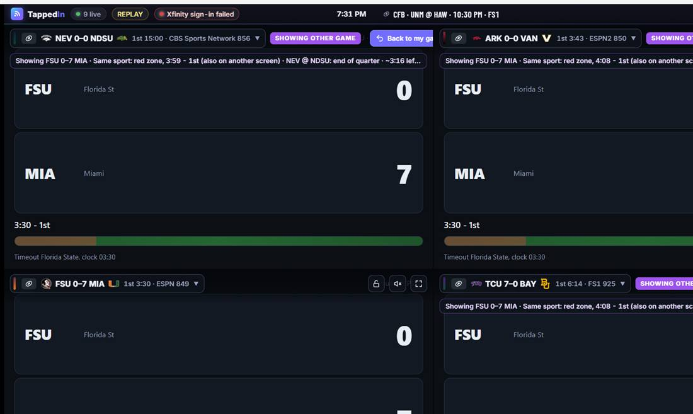
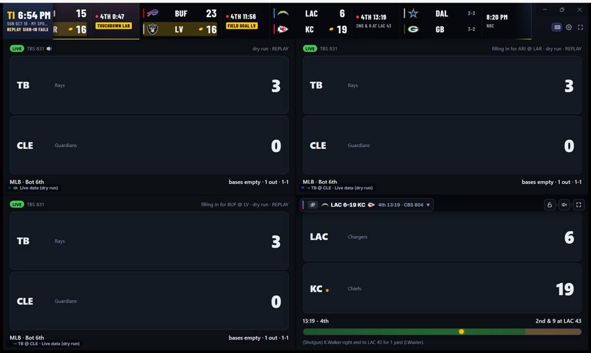
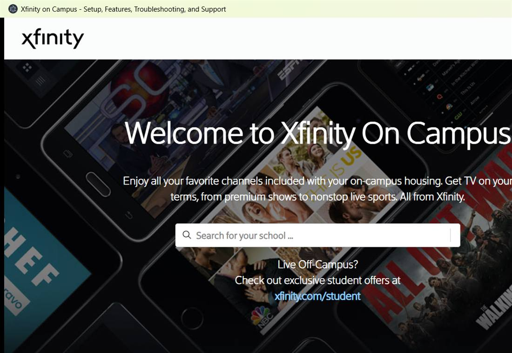
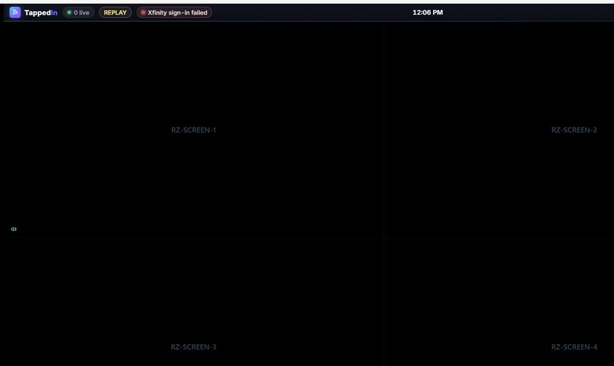
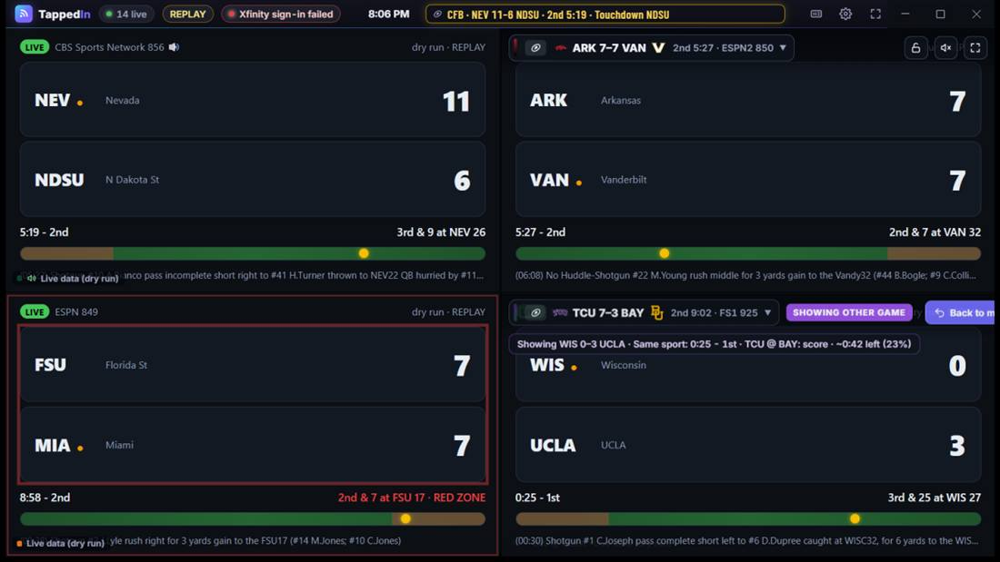
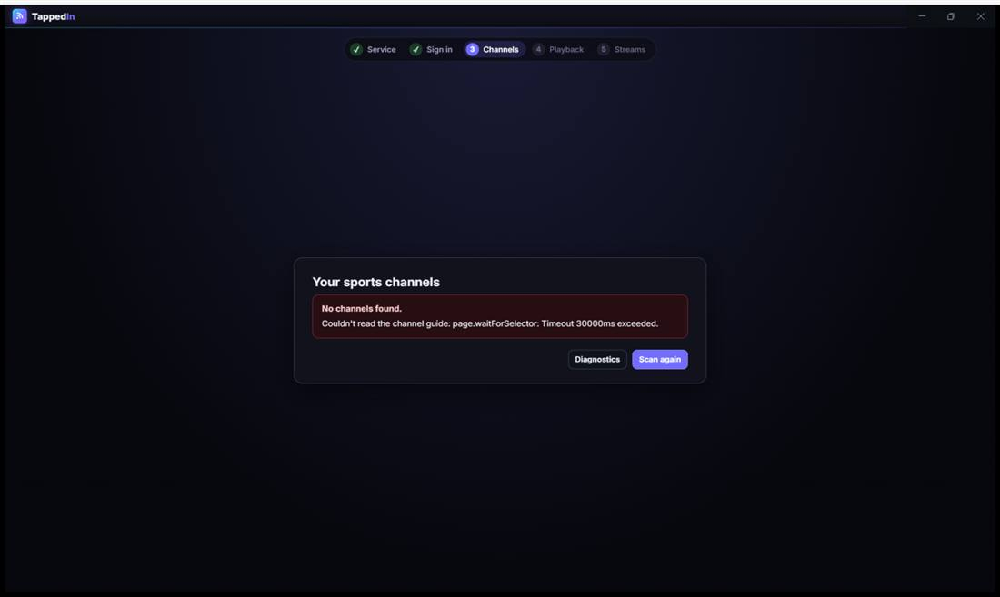
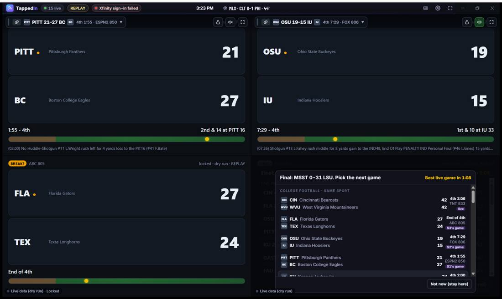
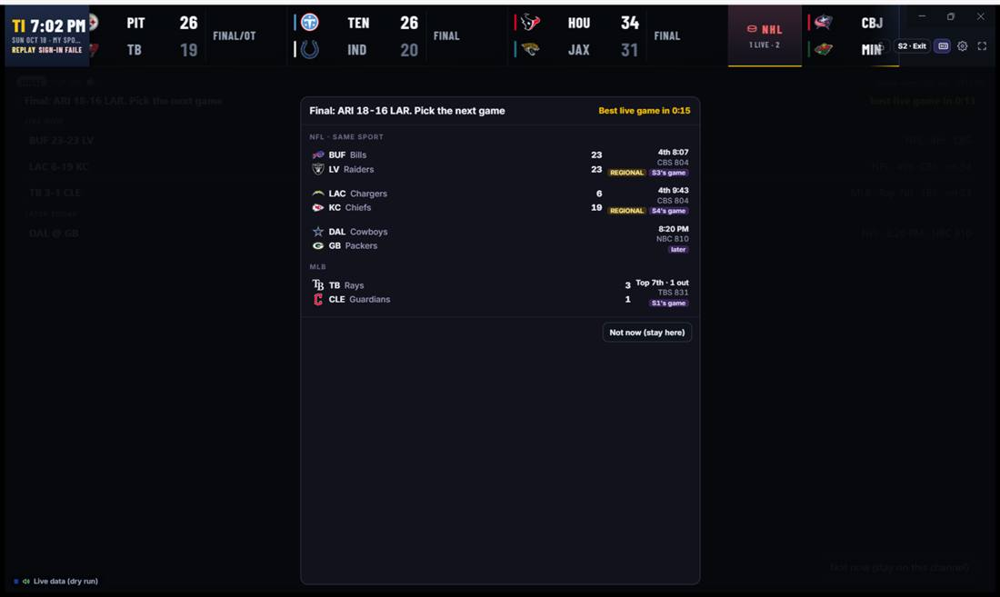
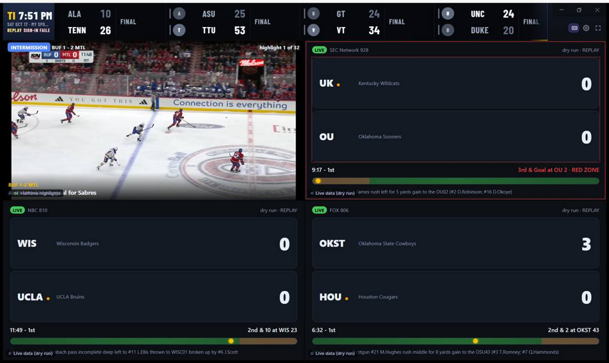

# Overnight review: 2026-10-20

Seven backend reviewers (six areas plus a triage pass on bugs the critics found) and seven UX critics went over `main` (3dce3ca → 639531f) during the night. The critics used the app in replay mode with data tiles instead of video, each with its own sandbox (separate ports, a scratch `LOCALAPPDATA`, copied recordings). Nobody signed in to a real TV service.

## 1. Summary

- **32 PRs opened** (#8–#39), one bug each, all on `overnight/fix-*` branches off the latest `main`. I checked every PR myself: merged onto the latest main, each one passes the full suite and `npm run typecheck`, and none touches the CFB golden files. **All 32 also merge together with no conflicts**, and the combined branch passes 49 test files / 438 tests (main has 406).
- **Urgent:** none.
  - **Secrets:** no secrets, cookies, `.state/`, `.env` or browser profiles anywhere in git history (all branches).
  - **`npm audit`:** 0 vulnerabilities (castLabs Electron can't be audited because it's a GitHub tarball).
  - **Crash bugs:** six fixed PRs stopped the app or a script from crashing or hanging on an error: #9, #13, #19, #20, #22, #23.
- **Look at first:**
  1. **Your unpushed commit `49ebc87`** (audit fixes on local `tickers-fullscreen-tennis`) isn't on GitHub or in main.
     - Cherry-picked onto main, it conflicts only on files it deletes (spike scripts, `selftest.ts`, `badge.js`): keep the deletions. It conflicts with none of the overnight PRs.
     - Its new `test/server.test.ts` sends the old `x-redzone` header; main now requires `x-tappedin`, so that test will fail until you update it.
  2. **The four PRs that change which game gets picked:** #8, #18, #26, #30. Each one brings the code in line with the README/spec, CFB golden output is unchanged, and none changes a threshold. Still, review them as behavior changes.
  3. **The new `main` moves your data folder the first time it runs.** The TappedIn rename renames `%LOCALAPPDATA%\RedZone` to `TappedIn`. After that, your local branch (which still uses `RedZone`) won't find your Xfinity sign-in.
  4. **The biggest product issue the critics found:** 6 of 7 independently saw several screens showing the same game. #30 fixes the worst case; the rest is a default you need to decide on (Decisions, item 1).

Detailed notes per area and per critic are in [`details/`](details/). The running log is [`progress.md`](progress.md).

## 2. Backend fixes (PRs)

Severity: **H** = crash, data loss or a feature broken for users; **M** = wrong behavior in a real situation; **L** = edge case or tooling.

| PR | Area | Fix | Sev | Test added |
|---|---|---|---|---|
| [#8](https://github.com/omcaul13/redzone/pull/8) | Engine (NHL) | The NHL power-play hot moment never fired with live data; it worked only on rebuilt days. *(Changes picks.)* | H | `test/sports/nhl.test.ts` |
| [#9](https://github.com/omcaul13/redzone/pull/9) | Server | Any web page could crash the app by requesting `//` (an unhandled rejection). | H | `test/server-errors.test.ts` |
| [#12](https://github.com/omcaul13/redzone/pull/12) | Engine | A stream error unlocked a locked screen, and lost a game-over "Not now". | H | `test/director.test.ts` |
| [#13](https://github.com/omcaul13/redzone/pull/13) | Logging | A failed log write (file locked, disk full) crashed the app. | H | `test/log.test.ts` |
| [#30](https://github.com/omcaul13/redzone/pull/30) | Engine | After a game ended, the auto-pick copied another screen's home game while a free game was only in a commercial. *(Changes picks.)* | H | `test/director.test.ts` |
| [#32](https://github.com/omcaul13/redzone/pull/32) | App | Replay and dry run waited up to 10 minutes for a real TV sign-in. | H | `test/app-startup-signin.test.ts` |
| [#33](https://github.com/omcaul13/redzone/pull/33) | Providers | YouTube TV showed "Signed in" while signed out (config only). | H | `test/shell-provider.test.ts` |
| [#10](https://github.com/omcaul13/redzone/pull/10) | Highlights | The reel asked ESPN for tennis summaries, which don't exist; that starved other sports' clips. | M | `test/highlights.test.ts` |
| [#11](https://github.com/omcaul13/redzone/pull/11) | Providers | A bad `tuning`/`family` in a user's provider override stopped the app from starting; now it's dropped with a warning, as documented. | M | `test/providers/config.test.ts` |
| [#14](https://github.com/omcaul13/redzone/pull/14) | ESPN polling | The poller kept every timer it ever made (1,820 after 2 idle hours). | M | `test/live-source.test.ts` |
| [#15](https://github.com/omcaul13/redzone/pull/15) | UI | Hotkeys fired while typing in the diagnostics JSON editor or a select. | M | `test/ui-hotkeys.test.ts` |
| [#16](https://github.com/omcaul13/redzone/pull/16) | Controller | A newer command or a stream limit now ends a standby load (it waited 25 s, then cut to the old game). | M | `test/controller-standby.test.ts` |
| [#18](https://github.com/omcaul13/redzone/pull/18) | Engine | Tier 2/3 fill-ins are now ordered by normalized score, as the README and spec say, not by the sport's own order. *(Changes picks.)* | M | `test/ranker.test.ts` |
| [#19](https://github.com/omcaul13/redzone/pull/19) | Highlights | A failed reel refresh crashed the app (unhandled rejection). | M | `test/highlights-service.test.ts` |
| [#21](https://github.com/omcaul13/redzone/pull/21) | Health | A playing video checked more than 4 s apart was read as stalled and re-tuned. More likely once 49ebc87 lands. | M | `test/health.test.ts` |
| [#22](https://github.com/omcaul13/redzone/pull/22) | Recording | A cut-off last record crashed replay, sim and fetch-day. | M | `test/recording.test.ts` |
| [#24](https://github.com/omcaul13/redzone/pull/24) | Sim | `--by-sport` missed sports brought in by auto-picks (10/17: 9.7 of 34.7 screen-hours covered). | M | checked by hand |
| [#26](https://github.com/omcaul13/redzone/pull/26) | Engine (MLB) | At Low, an MLB inning break was used as another screen's fill-in. Partial: about the first 85 s of each break are blocked. *(Changes picks.)* | M | `test/sports/mlb.test.ts` |
| [#28](https://github.com/omcaul13/redzone/pull/28) | Server security | DNS rebinding: the app now refuses requests with a foreign `Host` header, so a page can no longer read `/api/state`. | M | `test/server-host.test.ts` |
| [#29](https://github.com/omcaul13/redzone/pull/29) | Engine | A halftime longer than the max restarted the reel every ~20 s. | M | `test/director.test.ts` |
| [#31](https://github.com/omcaul13/redzone/pull/31) | App | Closing Diagnostics restarted the replay and ran two feed loops. | M | `test/app-replay-resume.test.ts` |
| [#34](https://github.com/omcaul13/redzone/pull/34) | Settings | The "Follows the action" sound setting wasn't saved. | M | `test/audio-config.test.ts` |
| [#35](https://github.com/omcaul13/redzone/pull/35) | UI | Opening a game list from the keyboard left focus on the button, so typing "LSU" opened Settings. | M | none (no DOM tests); checked on a page |
| [#37](https://github.com/omcaul13/redzone/pull/37) | Replay | A replay started before the recording begins now jumps to the first record instead of showing "No games today". | M | `test/app-replay-start.test.ts` |
| [#39](https://github.com/omcaul13/redzone/pull/39) | UI | "Use for all screens" dropped the app's "Only N games free" message. | M | none (no DOM tests) |
| [#17](https://github.com/omcaul13/redzone/pull/17) | Diagnostics | The export kept `;jsessionid=` session ids from school sign-in URLs. | L | `test/setup/diagnostics.test.ts` |
| [#20](https://github.com/omcaul13/redzone/pull/20) | Shell | Electron failing to start crashed or hung the app; now it reports the error. | L | `test/shell-start.test.ts` |
| [#23](https://github.com/omcaul13/redzone/pull/23) | Sim | `sim --compare` crashed on a fresh clone with no `logs/`. | L | checked by hand |
| [#25](https://github.com/omcaul13/redzone/pull/25) | Tests | Replay tests read your editable config; removing `cfb` failed 10 tests. | L | test-only |
| [#27](https://github.com/omcaul13/redzone/pull/27) | Recorder | Restarting `npm run record` re-saved every final. | L | checked by hand |
| [#36](https://github.com/omcaul13/redzone/pull/36) | README | Two paths contained a literal tab and backspace (4 critics noticed). | L | `test/readme.test.ts` |
| [#38](https://github.com/omcaul13/redzone/pull/38) | Ticker | "RED ZONE" and other hot-moment tags now end when the moment does, not 45 s later. | L | `test/ticker-model.test.ts` |

**Merge notes.** Some PR pairs edit the same files: #9 and #28, #10 and #19, #12 and #29, and #15 and #35, plus #30, #31, #32 and #34 in `src/app.ts`/`director.ts`. I checked that each pair merges cleanly in either order, and all 32 merge together. #16, #18, #21, #26 and #29 touch files 49ebc87 also changes; `git merge-tree` shows no conflicts.

## 3. Backend issues found but not fixed

Each item says why it wasn't fixed and what I recommend. Full evidence (file:line) is in [`details/`](details/).

**Your decision (behavior or design):**

| Issue | Why not fixed | Recommendation |
|---|---|---|
| The game-over auto-pick only sees games in play. A tied game in a commercial is invisible to it, so it picks a 20-point game, or a different sport. | Ranking every live game changes all 4 CFB golden sequences (tuning). | Make the auto-pick take the picker list's first entry (the list already sorts same sport first, then closest). #30 adds the `includeBreaks` option this needs. |
| When every live game is already on a screen, the auto-pick adopts a copy as the new home, and saves that sport for the screen (`screenSports: nhl,nhl,nhl,nhl`). | Design. | Never make a duplicate the home: stay on the picker or final. Don't save a sport from an auto-pick. |
| No crash handlers (`uncaughtException`/`unhandledRejection`): any engine-tick error closes the window. | Belongs in `scripts/start.ts` (collaborator's file), and log-and-continue versus exit is your call. | Log the error and keep running, with a per-minute crash counter that exits if it's looping. |
| The ESPN date, recording folder and log file are fixed at startup. A session past midnight ET shows yesterday's games. The 10/17 recording had 7 CFB games still live after midnight. | Behavior change. | Roll the date at about 6 AM ET, and keep yesterday's games while any are live. |
| Two screens can land on the same regional channel (e.g. two ABC games) without the duplicate flag. A screen can also fill in with another game on its own home channel, which shows the same commercial. | Changes CFB picks (golden still passed in a quick test). | Treat the same channel number as the same game in `director.ts`. |
| Halftime flip-flop: ESPN goes "End of 2nd" → "15:00 3rd" → "Halftime", and the reel ends, then restarts 6 s later. | Touches both break detectors (one is in #26). | When ESPN re-enters HALFTIME, keep the previous state until a new play. |
| A halftime reel keeps playing forever if its game's data stops (e.g. the end of a recording); the 25-minute cap isn't applied. | Found late; needs a director change. | Apply the halftime max even when the data is stale. |
| Sling shows "Signed in" without an account (its free tier shows the guide), and Diagnostics' sign-in step shows a false ✓. | Needs a positive signed-in signal per provider, plus site research. | Add a `signedInPattern` or selector (an account/profile element) to the provider schema. |
| Xfinity On Campus: closing the sign-in window doesn't end the 10-minute wait, in live mode too (`portalHandoff` in `electron/main.cjs`). | Electron main, no test harness. | Handle the window's `closed` event the way `interactiveSignin` does. |
| The old window controller keeps running after a "configure" rebuild, and can leave a screen stuck in ERROR (`src/app.ts` `attachController`). | Touches `app.ts`, which 49ebc87 also edits. | Stop the old controller before attaching the new one. |
| `npm run sim` can't evaluate tennis: tour matches are "unconfirmed", and `--full-lineup` doesn't override that despite its doc. | Engine change. | Let `--full-lineup` override unconfirmed channels. |
| Window hotkeys work during first-run setup (T saved a setting). | One line in `main.tsx`, which #15 also edits. | Ignore hotkeys except Esc while setup shows; easy after #15 merges. |
| Tab reaches invisible (opacity 0) overlay buttons, and Enter fullscreens a screen. | The fix is CSS in `src/ui/style.css` (collaborator's file). | Show the overlay on `:focus-within`. |
| If "Start watching" fails at the end of setup, the app drops to an empty grid with no polling. | Recovery is a design call. | Show the error and a Retry button on the last setup step. |

**Low severity (one line each):**
- A failed YouTube cache write crashes the app (only with `YT_API_KEY`). Same one-line fix as #13.
- Chrome mode: Alt+P after closing the panel crashes. Replaying a date with no recording prints a stack trace.
- Two log lines can include full URLs (`controller.ts:520`, Electron console in `shell.ts:196`).
- Live recording is on by default (7–52 MB/day), and old recordings and logs are never deleted.
- After one failed scoreboard poll, the next waits 60 s instead of 12 s.
- YouTube searches for tennis finals can use up the 40/day cap.
- A suspended or delayed game keeps its sport polling at the live rate all day; `record.ts` never finishes on those days.
- A home game that's final keeps getting play-by-play polls when nothing else is available.
- Small resource leaks: responses after `stop()` are still fed in, error bodies aren't drained, Retry-After waits can't be cancelled, and replay/sim leak a file handle when stopped early.
- Not atomic: the URL cache, window targets and `setup.json` aren't written atomically (49ebc87 fixes only `settings.json`).
- Possible race: a sign-in "ok" during a service switch could scan with the old views (unverified).
- Diagnostics export still includes page error text and guide labels. The spec says "no page text": decide.
- Controller: the newest command can be left unapplied after 5 mid-tune rounds; a stream limit on a visible screen doesn't turn standby off first (README line 335); a failed tune that lands back on the old channel goes unnoticed.
- Tests: a missing golden file is regenerated and passes; sim `--to 1:30` is compared as a string; `--full-lineup` fake channel numbers can collide.
- **Memory:** an older-laptop critic saw Electron renderer memory grow from 268 MB to 1,057 MB in 24 minutes. Triage ran the tile, picker and halftime pages for 10+ minutes and they stayed flat at about 90 MB, so the leak is probably in reel video, YouTube or the UI view. Not reproduced. Worth a one-hour run with real video.

**Biggest test gaps** (no tests on main): `windows/controller` (49ebc87 adds some), `server` (#9/#28 add some), `pages`, `highlights/service`, `LiveSource`, `Engine.setConfig`, settings save/load, and replay of a recorded non-CFB scoreboard. Replay and the recorder were checked for every sport: all replay correctly, and all invariants held over 100 sims of 50 recorded days.

## 4. User feedback

Seven critics worked independently, none seeing the others' notes: first-timer, CFB die-hard, multi-sport fan, Philo/Sling student, casual viewer, keyboard/accessibility user, and older-laptop user. Items are ranked by how many critics raised each one independently, then by severity. Effort: S < 1 day, M a few days, L a week or more.

### 4a. Bugs and things that don't work as intended

| # | Problem | Critics | Status / suggested fix | Effort |
|---|---|---|---|---|
| 1 | **Replay and dry run wait for a real sign-in.** The window sits empty for up to 10 minutes, then a red "Xfinity sign-in failed" chip stays up for the whole replay. | 6: first-timer, CFB, multi-sport, casual, laptop, a11y | Wait fixed by **#32**. Check whether the chip still shows; in replay/dry run it should say nothing. | S |
| 2 | **The same game on several screens.** Fill-ins and auto-picks copy another screen's game ("[DUPLICATE: only option]"). Examples: 3–4 screens on FSU @ MIA, TCU @ BAY, or a baseball game; all 57 fill-ins on a thin Sling lineup; duplicate homes for the rest of the night. | 6: first-timer, CFB, multi-sport, Philo, casual, laptop | **#30** fixes the duplicate home when a free game exists. The rest comes from `allowDuplicates: true` by default. Suggested: if the only option is a copy, stay home. **Decision 1.** | S |
| 3 | **Empty and stopped states look broken.** Black screens titled "RZ-SCREEN-2"; "No games today" before the recording starts; UNKNOWN badges with "4 live" during data gaps; a frozen end of replay with reels looping. A game going live later never fills an empty screen. | 6: first-timer, CFB, multi-sport, Philo, casual, laptop | Replay start fixed by **#37**. Use the idle page for screens without a home, plus a "Waiting for scores…" / "Replay over" state, and retry the startup pick when a watchable game goes live. | M |
| 4 | **Overlaps and clipping.** The "Live data (dry run)" tag covers the last-play line, the "Halftime highlights" tag covers clip captions, the header row overflows at half width (Back to my game covers lock/sound/fullscreen, or gets cut off at 1280×720), and the big-ticker label is truncated. | 7: all | CSS in `style.css` (collaborator's file; coordinate). Wrap the header row in narrow cells. | S |
| 5 | **The game-over auto-pick picks oddly.** A blowout over a tied game; a different sport while a same-sport game is live; a copy of another screen's game. The countdown doesn't name the game it will pick. | 4: first-timer, CFB, multi-sport, Philo | Duplicate case fixed by #30. Use the picker's first entry and show its name in the countdown. **Decision 3.** | S–M |
| 6 | **The screen stays on a fill-in after the home game resumes**, for the 30 s minimum. Missed snaps in close finishes: UNC @ DUKE's go-ahead TD, AUB @ UGA tied with 0:58 left, ARI @ LAR first-and-goal at the 1. | 3: first-timer, CFB, multi-sport | Tuning: skip `minSubstituteSeconds` when the home game is in a hot moment or close and late. **Decision 2.** | S |
| 7 | **"Signed in" with no sign-in** (YouTube TV, Sling); setup then fails at Channels. | 2: first-timer, Philo | YouTube TV fixed by **#33**. Sling needs a positive signed-in check (section 3). | M |
| 8 | **It switches when the forecast says the break is almost over** (11%, 9%, 30% chance), after the dwell runs out. | 2: CFB, multi-sport | Possible bug: the director may act on the earlier BREAK state without re-checking the threshold. Needs a look. | S |
| 9 | **Fill-ins land on games in their own break** (MLB between innings, a CFB timeout). | 1 critic (multi-sport) + engine reviewer independently | MLB partly fixed by **#26**. A last play that's a timeout or end of period should block a substitute. | S |
| 10 | **Two game-over pickers at once:** the overlay's and the tile's, with different countdowns (worst in fullscreen). | 2: multi-sport, a11y | Hide the tile's picker while the overlay shows. | S |
| 11 | **Stale big-ticker tags** ("RED ZONE" after the drive, "TOUCHDOWN" at half). | 2: first-timer, CFB | Fixed by **#38**. | — |
| 12 | **The log says "you picked X as home" for automatic picks.** | 2: first-timer, CFB | Log as `AUTO_PICK`/startup pick. | S |
| 13 | **`--setup-demo` ends on "Starting TappedIn…" forever.** | 2: first-timer, laptop | Show "Demo finished". | S |
| 14 | **Two games on one channel offered together** (the picker; four tennis screens on Tennis Channel). | 2: Philo, multi-sport | Mark "same channel as S1" in the list. | S |
| 15 | **Hotkeys fire while typing**, and S/T work during setup. | 1: a11y (+ UI reviewer) | Fixed by #15 and #35; the setup part is in section 3. | — |
| 16 | **Halftime reel → game → reel within 100 s.** | 1: CFB (triage confirmed) | Section 3 (halftime flip-flop). | S |
| 17 | **Picking a game on a locked screen silently unlocks it.** | 1: CFB | Decision 9. | S |
| 18 | **A soccer full time (90'+12') was treated as halftime** and played a reel instead of the game-over picker. | 1: CFB | **Not triaged.** Probably a soccer phase-parsing bug; worth a test. | S |
| 19 | **Closing Diagnostics restarts the replay; the sound setting isn't saved; "Use for all screens" fails silently.** | 1 each: Philo, CFB, multi-sport | Fixed by **#31**, **#34**, **#39**. | — |
| 20 | Smaller items: the forecast shows "~11:39 left" in the last NFL minute; the halftime reel spoils games during a replay (clips fetched today); the 3-screen icon doesn't match the grid; the reel shows two different scores for one game. | 1 each | Cap the "left" estimate; label clip scores "then: 11-12". | S |

Screenshots:

| | |
|---|---|
|  *#2: three screens fill in with FSU @ MIA in the first 35 s (casual)* |  *#2: three screens on TB @ CLE (multi-sport)* |
|  *#1: replay opens the real Xfinity page and waits (casual)* |  *#3: four black "RZ-SCREEN-n" boxes, "0 live" (casual)* |
|  *#4: header past the edge; "Live data" tag over the play line (laptop)* |  *#7: "Sign in" ticked, then a developer error at Channels (first-timer)* |
|  *#5: the picker lists the tied game first; the auto-pick chose a blowout (CFB)* |  *#10: two pickers, two countdowns (multi-sport)* |

### 4b. Friction and usability

| # | Problem | Critics | Suggested fix | Effort |
|---|---|---|---|---|
| 1 | **Switching feels busy.** About 17 changes per screen-hour at Low, 20–40 s trips home, end-of-quarter pile-ups when every game breaks at once, High "unwatchable" (32.6 switches per screen-hour), and H only buys about 20 s. | 3: first-timer, CFB, casual | "Stay home" when every candidate is in a break; a short hold after returning home; H means "for this break". A "Calm" level (see 4c). | M |
| 2 | **Switches aren't explained.** The "why" line is full of numbers ("~0:21 left (10%)"), the only always-visible cue is a tiny gray "filling in" tag, and nothing is announced to screen readers (no `aria-live`). | 3: first-timer, casual, a11y | A 3–5 s plain banner per switch ("Commercial on UNC @ DUKE: showing ALA @ TENN"), keeping the numbers in the tooltip; a polite live region per screen. | M |
| 3 | **Setup dead ends.** No Back or "Choose another service" after sign-in; Philo, Hulu, Fubo and BU searches end at "see CONTRIBUTING.md"; developer errors like `page.waitForSelector: Timeout 30000ms`; "Experimental" explained only in a tooltip; the one Tested service is listed 3rd. | 3: first-timer, Philo, casual | Back on every step; one line per unsupported service ("Philo has no sports networks; try…"); plain error copy with buttons; show each provider's `notes`; Tested first. | M |
| 4 | **Jargon and codes:** "dry run" next to REPLAY, MCBB/WCBB/UCL/LIGA, an unlabeled ticker icon, "Same sport:", and football words for tennis/hockey ("@", HALFTIME, BREAK for SUSPENDED). | 3: first-timer, casual, multi-sport | Plain labels; per-sport words. | S |
| 5 | **Games you can't watch clutter everything:** game lists, the ticker (unwatchable games not marked), sport-grid counts that include ESPN+-only games, and a 60-network settings list. | 2: Philo, multi-sport | "Hide what I can't watch", dimming in the ticker, "1 live · none on your channels", "carried first". | M |
| 6 | **The ranker ignores close-and-late games and rankings:** a red zone in a 28-point game beats a tied 4th quarter, and upsets mean nothing. | 2: first-timer, CFB | A CFB "two-minute drill in a one-score game" like NFL's, a blowout floor for fill-ins, and an upset signal. **Decision 5.** | M |
| 7 | **Sound:** "Follows the action" switched 64 times in 3.5 h and ignores a locked team; the default stays on screen 1 even while it's on a fill-in. | 2: CFB, casual | A minimum hold time, no audio for blowouts, the locked screen wins ties. | S |
| 8 | **Halftime and intermission play reels while great live games are on** (an NHL intermission is about 19 min of clips during 11 live CFB games). | 2: multi-sport, CFB | A setting: "At halftime: live game first / highlights". **Decision 6.** | S–M |
| 9 | **Other sports intrude on a CFB Saturday:** a soccer startup pick, EPL/NHL filling CFB breaks, the mini ticker rotating to MLS during a 42-42 4th quarter. | 2: CFB, multi-sport | Per-screen "fill-ins from: same sport / my screens' sports / any". | M |
| 10 | **Text size, contrast and motion:** 10.5 px headings at 3.6:1, badges just under 4.5:1, red zone shown only by color, and most animations ignore reduced motion. | 2: a11y, laptop | A `:focus-visible` style, contrast tokens, a reduced-motion pass, a text-size setting. | M |
| 11 | **Keyboard:** L and H act on "the screen under the mouse"; focus is lost after every change; the settings drawer isn't a dialog; the ticker and game-over picker can't be reached by keyboard. | 1: a11y | A keyboard "current screen" (Tab/F6 or Ctrl+1–4) fixes most of it. | M |
| 12 | **Performance:** the big ticker triples the UI's CPU (even paused); every tile fetches the 65 KB state every second, even hidden or minimized. | 1: laptop | Push updates to tiles (SSE or a per-screen slice); a compositor-only ticker; pause when hidden. | M |
| 13 | **Screen count can only be changed by re-testing streams;** 2 screens are no bigger than 4 on a 16:9 laptop. | 1: laptop | A plain "screens" setting; stack 2 screens vertically on wide-short windows. | S–M |
| 14 | **The channel-scan result flashes by;** a thin lineup is never explained. | 1: Philo | Pause on the ✓/✗ network grid; "you get 4 of 12 networks; 2 screens may suit you". | S |
| 15 | **Tennis tiles show only sets ("0 / 0, WTA · 1st"),** no games, server or tiebreak. | 1: multi-sport | A tennis tile layout. | M |
| 16 | **Export says "send it to the project owner"** without saying how. | 1: Philo | A link or email. | S |

*4b-8: an NHL intermission reel while another screen is at 3rd & goal (multi-sport)*

### 4c. New feature ideas

| Idea | Critics | Effort |
|---|---|---|
| **Replay controls in the UI:** the recording's time range, a speed control, a "Replay over / pick another day" card | 3: CFB, casual, first-timer | M |
| **"Try it without a TV service"** button on the Welcome screen (watch a recorded Saturday) | 2: first-timer, casual | M |
| **"Protect the finish" / "my team" / upset alert:** never cover your team's late snaps; an upset as a hot moment | 2: first-timer, CFB | M |
| **First-run teaching:** a 3-tip tour, a toast on the first switch, a card explaining the startup pick | 2: first-timer, casual | S |
| **"What you missed" chip** when a screen comes back home ("TD UNC while you were away") | 2: first-timer, CFB | M |
| **Choose which sports may fill which screen** (or "CFB only today") | 2: multi-sport, CFB | M |
| **Text-size control** | 2: laptop, a11y | S |
| A dedicated **RedZone chase screen** with no home that always shows the best moment | 1: CFB | M |
| A **"Calm" level** below Low (quarter breaks, halftime, game over only) | 1: casual | S |
| **Low-power mode** (no big ticker, pause hidden views, no standby) and a hardware hint in "How many screens?" | 1: laptop | M |
| **Lineup advisor:** what a service carries before sign-in, games you're missing and why, combining two services, ESPN+ | 1: Philo | L |
| **Accessibility settings:** announce switches, a longer game-over countdown, a "G" key for the game menu, a text summary of all screens | 1: a11y | M |
| **Duplicate-aware layout:** merge two screens on one channel into a bigger one | 1: multi-sport | L |

## 5. Decisions for you

- [ ] **1. Duplicates by default.** Keep `director.allowDuplicates: true`, or stay home when a copy is the only option? 6 of 7 critics hit this.
- [ ] **2. Return home faster in close finishes.** Let a hot or close-and-late home game end the 30 s minimum on a substitute? 3 critics; this is tuning.
- [ ] **3. Game-over auto-pick.** Use the picker list's first entry, which sees games in a commercial? It changes CFB golden output.
- [ ] **4. Review and merge the 32 PRs.** The four that change picks are #8, #18, #26 and #30. Push 49ebc87 too, and update its `x-redzone` test header.
- [ ] **5. Ranking.** Close-and-late over a blowout red zone, and rankings/upsets as a signal? 2 critics.
- [ ] **6. Halftime and intermission.** Live game first, or the reel? 2 critics.
- [ ] **7. Crash policy.** Add global handlers in `scripts/start.ts` (collaborator's file): log and keep running, or exit?
- [ ] **8. Past-midnight sessions.** Roll the ESPN date at about 6 AM ET?
- [ ] **9. A pick on a locked screen.** Keep the lock?
- [ ] **10. UI fixes in `style.css`.** The overlaps (4a-4) and invisible-focus buttons are in the collaborator's file. Who makes them?

## Appendix: what's left on disk

- **Worktrees (50):** in `C:\Users\omcau\code\redzone-wt\` (review, fix, critic, verify and report worktrees). Their `node_modules` (and two `recordings\<day>`) are **junctions**. Don't delete these folders with PowerShell's `Remove-Item -Recurse`: through a junction it can delete the target's files, which here is your real `node_modules`. `C:\Users\omcau\code\redzone-wt\_tools\cleanup-worktrees.ps1` (try `-WhatIf` first) unlinks the junctions and then removes the worktrees with git. It keeps branches.
- **Full-size screenshots (about 23 MB):** `C:\Users\omcau\code\redzone-wt\notes\critics\<persona>\`. Only 12 small JPEGs are in this PR.
- **Critic sandboxes:** each has an uncommitted `config\tappedin.config.json5` edit (ports) and its own `.state\`. The scratch app data is under `C:\Users\omcau\code\redzone-wt\_localappdata\`. Nothing touched your real `%LOCALAPPDATA%\RedZone` or `C:\Users\omcau\code\redzone`.
